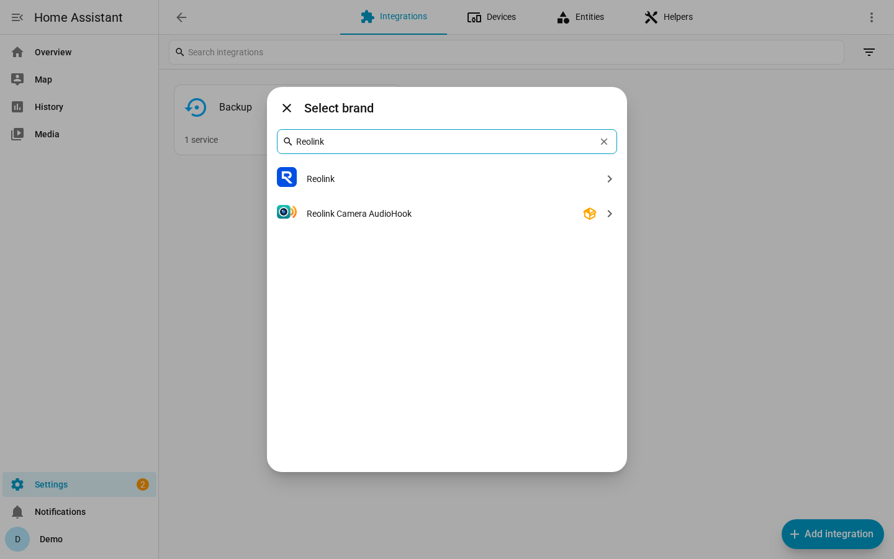
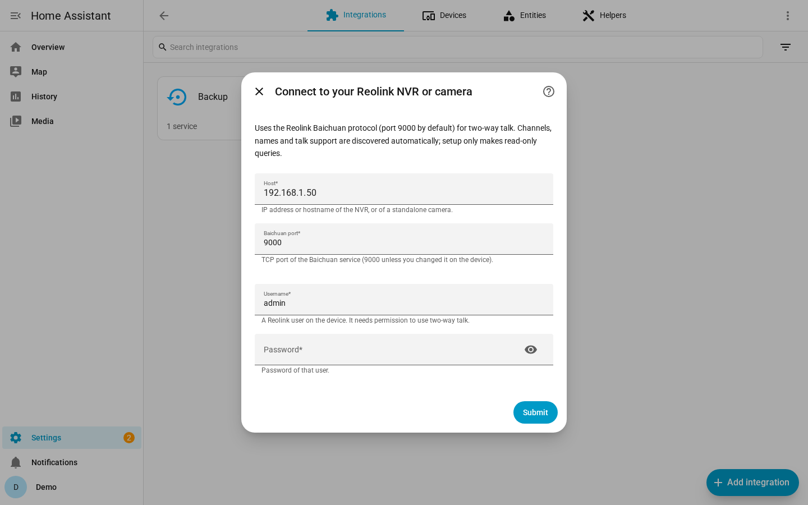
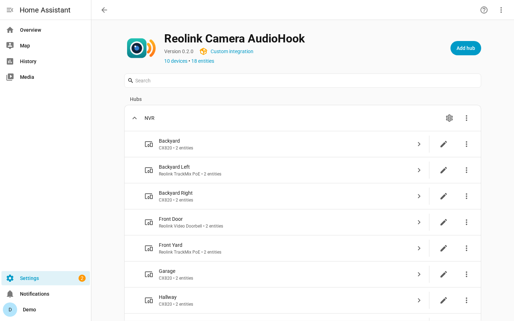
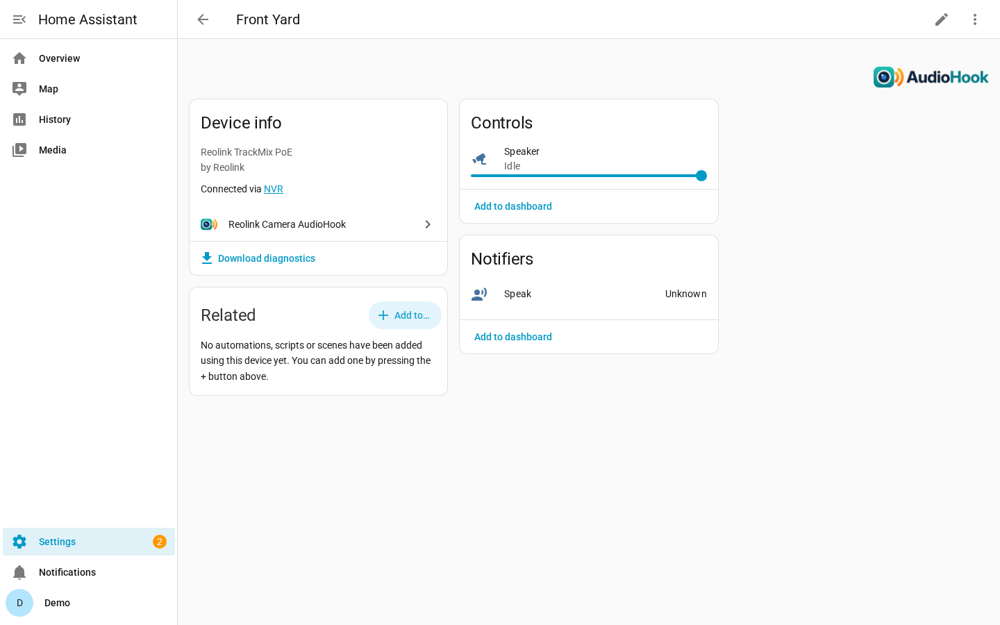
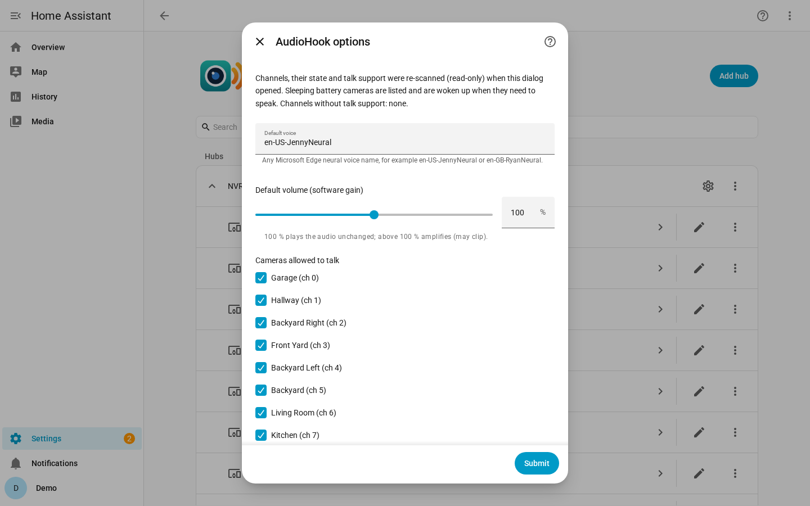
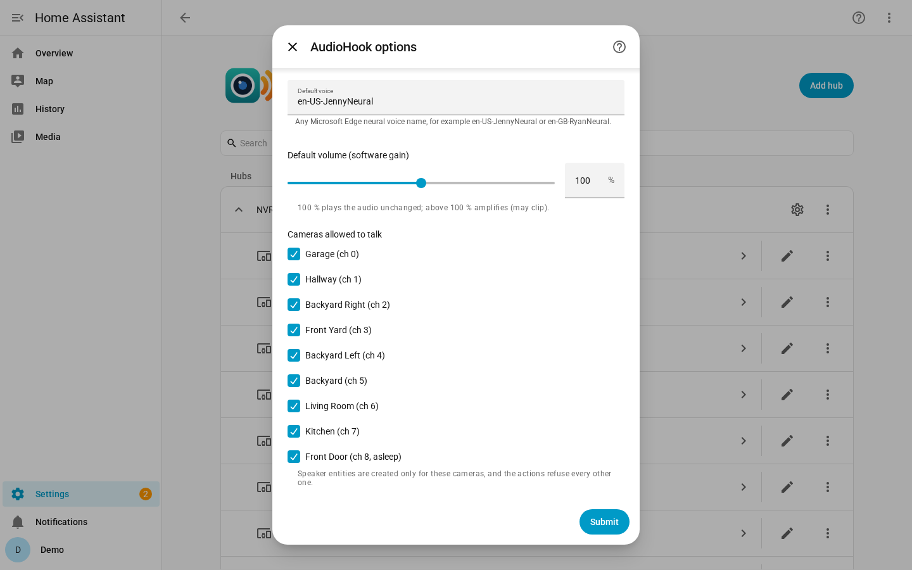
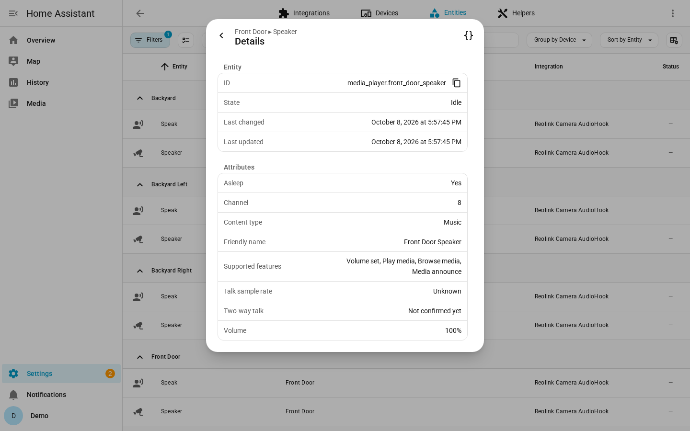
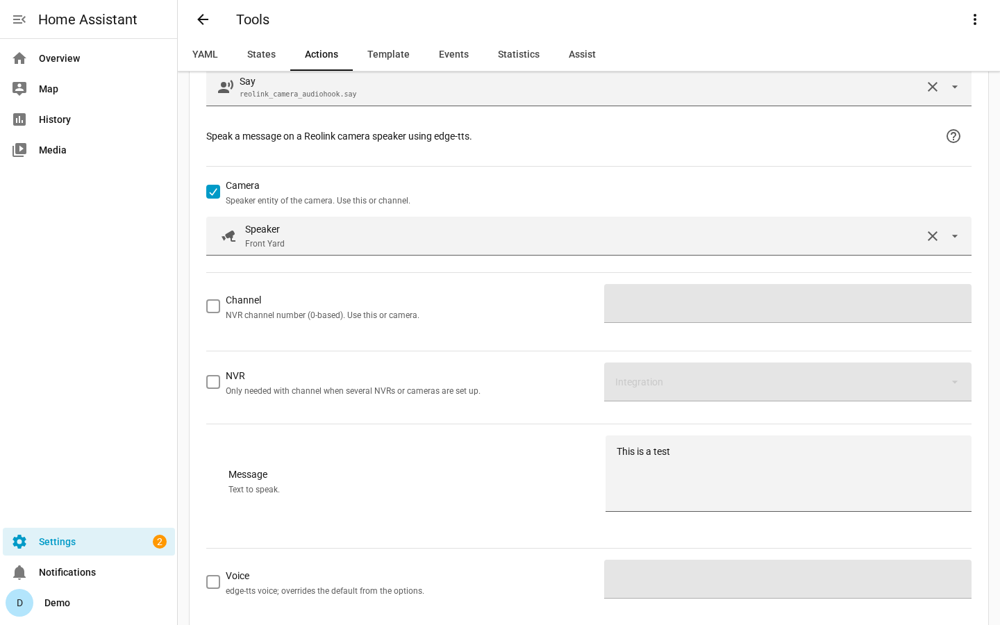
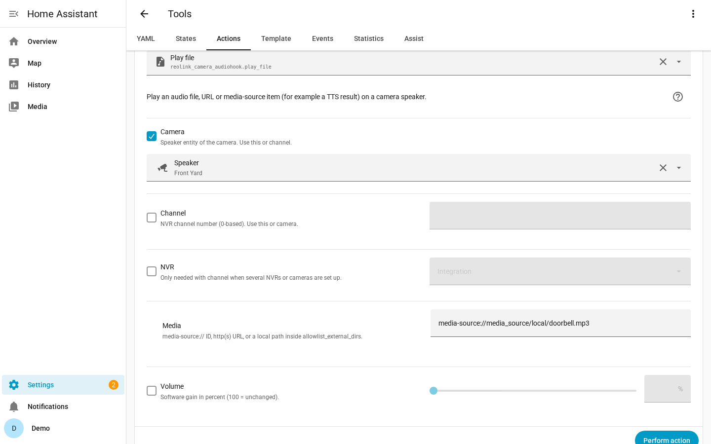

<p align="center">
  
</p>

<h1 align="center">Advanced Reolink Card</h1>

<p align="center">
  <a href="https://hacs.xyz"></a>
  
  <a href="LICENSE"></a>
  <a href="https://github.com/MainMaxton/advanced-reolink-card/actions/workflows/validate.yml"></a>
</p>

A Home Assistant custom integration that makes **Reolink camera speakers talk**.
It sends text-to-speech (or any audio file) through the camera's **two-way talk**
channel using Reolink's native **Baichuan** protocol (TCP port 9000 by default). It
works through an NVR with any number of channels, or directly with a standalone camera.

> **Renamed from "Reolink Camera AudioHook".** The integration domain changed from
> `reolink_camera_audiohook` to `advanced_reolink_card`, so Home Assistant treats it
> as a new integration: remove the old integration (and its HACS repository), install
> this one, add it again and update automations (`advanced_reolink_card.say`,
> `advanced_reolink_card.play_file`) and dashboards (`custom:advanced-reolink-card`).
> See the [CHANGELOG](CHANGELOG.md).

## Features

- **Text-to-speech on any Reolink camera speaker**: `advanced_reolink_card.say`
  with built-in [`edge-tts`](https://github.com/rany2/edge-tts) neural voices
  (default `en-US-JennyNeural`).
- **Play any audio**: `advanced_reolink_card.play_file` takes media-source IDs
  (local media, TTS results), `http(s)://` URLs or allow-listed local files.
- **Works with every Home Assistant TTS engine**: each camera gets a
  `media_player` speaker entity, so `tts.speak` (Piper, Google, Nabu Casa, ...)
  and `media_player.play_media` can target it. A `notify` entity per camera speaks
  messages via `notify.send_message`.
- **Automatic discovery**: channels, names, models, online/asleep state and
  two-way talk support are read from the device you enter. NVRs with any number of
  channels and standalone cameras are supported.
- **Camera card** (`custom:advanced-reolink-card`, loaded automatically): pick the
  features you want in the visual editor: **live video**, **PTZ** (hold-to-move
  direction pad, zoom, presets), **listen** to the camera microphone and
  **push-to-talk**, with half-duplex muting so you do not hear yourself. The
  matching Reolink camera, PTZ buttons and presets are found automatically.
  A `cameras` list puts several cameras on one card with tabs (and swipe) to
  switch between them; only the active camera streams.
- **Battery cameras and doorbells**: asleep cameras stay selectable and are
  **woken up** automatically before they speak.
- **Local and lightweight**: talk is pure Python, no Node.js, no cloud relay, and
  talk audio stays on your LAN. Live video and listening reuse Home Assistant's own
  camera streaming (built-in go2rtc / WebRTC) for the Reolink core cameras.
- **Robust**: talk sessions are serialised per NVR and always end with a
  `TalkReset`, even after errors; translated errors, reauth, reconfigure and
  diagnostics are included.

> **Status:** 0.4.0. Tested on a Reolink NVR with TrackMix PoE, CX820 and Video
> Doorbell cameras (16 kHz ADPCM talk). Not affiliated with or endorsed by Reolink.

## Requirements

- Home Assistant **2025.2** or newer. The integration icon/logo shown in the UI
  needs **2026.3** or newer (older versions show a placeholder).
- `ffmpeg`. Home Assistant's `ffmpeg` integration is used to decode MP3 and other
  formats (PCM WAV is decoded in pure Python). It works the same on HA OS,
  Supervised, Container and Core installs.
- Internet access for the built-in `say` action (edge-tts). `play_file`,
  `tts.speak` with a local engine such as Piper and the speaker entity work offline.
- The Baichuan port reachable from Home Assistant (default **9000**). On the
  NVR/camera it is under *Settings → Network → Advanced → Port settings* ("Media
  port" / "Basic service").
- A Reolink user on the device that is allowed to use two-way talk (it does not
  have to be the administrator account).
- For the card's **live video, PTZ and listen** features: Home Assistant's
  [Reolink integration](https://www.home-assistant.io/integrations/reolink/) set up
  for the same NVR/camera (it provides the camera, PTZ button and preset entities).
  Listening needs WebRTC, which Home Assistant provides through its built-in
  go2rtc on HA OS and Container installs.

## Installation

### HACS default store (coming soon)

Advanced Reolink Card is **not yet in the HACS default store**, so searching
in HACS will not find it until you add it as a custom repository (below). A
submission to the default store is planned.

### HACS (custom repository)

> [!NOTE]
> HACS can only add a custom repository when the GitHub repository is
> **public**. No HACS review is needed for this.

1. In HACS open the **⋮** menu and choose **Custom repositories**.
2. Add `https://github.com/MainMaxton/advanced-reolink-card` with
   category **Integration**.
3. Search for **Advanced Reolink Card**, then **Download**.

   [](https://my.home-assistant.io/redirect/hacs_repository/?owner=MainMaxton&repository=advanced-reolink-card&category=integration)
4. Restart Home Assistant.

### Manual

1. Copy `custom_components/advanced_reolink_card/` into your HA config directory
   so that you have `<config>/custom_components/advanced_reolink_card/manifest.json`.
2. Restart Home Assistant.

## Setup

*Settings → Devices & services → Add integration → **Advanced Reolink Card***

| Find the integration | Enter the device |
|---|---|
|  |  |

| Field | Default | Notes |
|-------|---------|-------|
| Host | | IP address or hostname of the NVR or camera, e.g. `192.168.1.50` |
| Baichuan port | `9000` | change it if you changed it on the device |
| Username | | a Reolink user with talk permission |
| Password | | stored only in the Home Assistant config entry |

During setup the integration logs in and only runs **read-only** queries: device
info, the channel list with online/asleep state (cmd 145), channel name and model
(cmd 318 / 44) and `TalkAbility` per channel (cmd 10). Sleeping battery cameras
are **not** woken during setup; their talk support is shown as "not confirmed yet"
and they remain selectable. Nothing is played.

The same discovery runs again in the background every time the integration
starts, and whenever you open the options, so new cameras and renamed channels
are picked up.

| Integration page | Camera device |
|---|---|
|  |  |

### Options

*Configure* on the integration page:

| Defaults: every talk-capable camera | Asleep cameras stay selectable |
|---|---|
|  |  |

- **Default voice**: any edge-tts voice, for example `en-US-JennyNeural` or
  `en-GB-RyanNeural` (`edge-tts --list-voices` lists them all).
- **Default volume**: software gain in %. 100 % plays the audio unchanged; above
  100 % amplifies it and may clip.
- **Cameras allowed to talk**: by default every channel that supports two-way talk
  *or might* (asleep/offline/not yet confirmed). Only channels that positively
  report "no talk ability" (and empty NVR slots) are left out. Speaker entities are created only for
  the selected cameras, and the actions refuse every other channel.
- **Allow non-admin users to use live talk**: off by default, so only
  administrators can use the live talk card.
- **Configure camera patrol limits**: tick it to continue to a PTZ camera picker and
  that camera's patrol settings (sweep arc from guard, speed, pause, tilt, settle time,
  auto-tracking, enabled). See [Per-camera limits](#per-camera-limits-arc-sweep).

**Reconfigure** (⋮ → *Reconfigure*) changes the address, port or credentials
without removing the entry. If the device rejects the stored password, Home
Assistant asks you to **re-authenticate**. **Download diagnostics** gives a
report with the password, username, address and device IDs redacted.

## Entities

Each allowed camera becomes a device (named after the camera) with:

- `media_player.<camera>_speaker`: `play_media` (media-source, URL), media browsing
  and `volume_set` (software gain). Use it with `tts.speak` and any TTS engine.
- `notify.<camera>_speak`: `notify.send_message` speaks the message with the
  default voice.

Entities become unavailable when the NVR/camera cannot be reached or the NVR
reports that camera as disconnected (checked every 2 minutes, read-only, without
waking battery cameras). An asleep camera stays available; its `sleeping`
attribute shows the state.



## Actions

### `advanced_reolink_card.say`

| Field | Required | Description |
|-------|----------|-------------|
| `camera` | one of | speaker entity, e.g. `media_player.porch_camera_speaker` |
| `channel` | one of | NVR channel number (0-based) |
| `config_entry_id` | no | only needed with `channel` when you have several devices |
| `message` | yes | text to speak |
| `voice` | no | edge-tts voice (overrides the default) |
| `volume` | no | 0-200 % software gain |

```yaml
action: advanced_reolink_card.say
data:
  camera: media_player.porch_camera_speaker
  message: "Hi! Please leave the parcel by the door."
  volume: 120
```

```yaml
action: advanced_reolink_card.say
data:
  channel: 0
  message: "This is a test"
response_variable: talk   # optional: sample rate, blocks sent, wake-up, timings
```



### `advanced_reolink_card.play_file`

`media_content_id` can be a `media-source://` ID (local media or a TTS result), an
`http(s)://` URL, or a local path inside `allowlist_external_dirs`.

```yaml
action: advanced_reolink_card.play_file
data:
  camera: media_player.porch_camera_speaker
  media_content_id: media-source://media_source/local/chime.mp3
```



### Any TTS engine via `tts.speak`

```yaml
action: tts.speak
target:
  entity_id: tts.piper   # or tts.google_translate_en_com, tts.home_assistant_cloud, ...
data:
  media_player_entity_id: media_player.porch_camera_speaker
  message: "Motion detected"
```

## Example automations

```yaml
alias: Greet visitors
triggers:
  - trigger: state
    entity_id: binary_sensor.porch_camera_person   # e.g. from the official Reolink integration
    to: "on"
conditions:
  - condition: time
    after: "08:00:00"
    before: "20:00:00"
actions:
  - action: advanced_reolink_card.say
    data:
      camera: media_player.porch_camera_speaker
      message: "Hello! Someone will be with you shortly."
mode: single
max_exceeded: silent
```

Doorbell press, any TTS engine through the speaker entity:

```yaml
alias: Doorbell announcement
triggers:
  - trigger: state
    entity_id: binary_sensor.front_doorbell_visitor
    to: "on"
actions:
  - action: tts.speak
    target:
      entity_id: tts.piper
    data:
      media_player_entity_id: media_player.porch_camera_speaker
      message: "Thanks, we are on our way."
mode: single
```

Play a chime on several cameras one after another:

```yaml
alias: Gate chime
triggers:
  - trigger: state
    entity_id: binary_sensor.gate_contact
    to: "on"
actions:
  - repeat:
      for_each:
        - media_player.porch_camera_speaker
        - media_player.driveway_camera_speaker
      sequence:
        - action: advanced_reolink_card.play_file
          data:
            camera: "{{ repeat.item }}"
            media_content_id: media-source://media_source/local/chime.mp3
mode: single
```

This integration works alongside the official Reolink integration. It opens its
own short-lived Baichuan connection for each message: login, talk, `TalkReset`,
logout.

## Camera card

The integration ships one Lovelace card, `custom:advanced-reolink-card`. In the
card's visual editor you choose the features you want:

| Feature | What it does |
|---|---|
| **Live video** (`video`) | Live view of the matching Reolink core camera entity, over Home Assistant's WebRTC (go2rtc). Falls back to Home Assistant's standard stream (HLS) and then to a refreshed still image. Tap to start; it never starts on its own. |
| **PTZ controls** (`ptz`) | Direction pad (press and hold moves, release sends *PTZ stop*, exactly like the core PTZ buttons), zoom in/out and a preset list when the camera has them. Only shown for PTZ cameras (for example TrackMix); other cameras stay view-only. |
| **Listen** (`listen`) | Speaker button that plays the camera microphone, with a volume slider. Uses the video's audio when live video is on, otherwise an audio-only WebRTC session. The card plays the audio itself so it can mute it. |
| **Push-to-talk** (`talk`) | Hold (or tap) to speak through the camera speaker (see [Live talk](#live-talk)). Half-duplex by default: listening is muted while you talk and for about 1.5 s after you release, so you do not hear your own voice coming back from the camera. |

The card is served by the integration and loaded on every dashboard
automatically. Add it from the card picker ("Advanced Reolink Card") or in YAML.

**PTZ camera with everything** (for example a TrackMix):

```yaml
type: custom:advanced-reolink-card
entity: media_player.front_yard_speaker   # this integration's speaker (talk target)
video: true
ptz: true
listen: true
talk: true
talk_auto_listen: true   # pressing talk also starts listening
volume: 80
```

**Battery doorbell, listen and talk without video:**

```yaml
type: custom:advanced-reolink-card
entity: media_player.front_door_speaker
listen: true
talk: true
mode: toggle
```

**View only, no talk** (any Reolink core camera):

```yaml
type: custom:advanced-reolink-card
camera_entity: camera.garage_fluent
video: true
talk: false
```

**Talk only** (what older `audiohook-talk-card` configs do):

```yaml
type: custom:advanced-reolink-card
entity: media_player.porch_camera_speaker
name: Porch
mode: hold
```

**Several cameras on one card** (tabs above the video, swipe on the video to
switch). Top-level options are defaults; each camera can override them:

```yaml
type: custom:advanced-reolink-card
video: true
ptz: true
listen: true
talk: true
volume: 80
default_camera: Front yard
cameras:
  - entity: media_player.front_yard_speaker
    name: Front yard
    icon: mdi:cctv
  - entity: media_player.garage_speaker
    name: Garage
    icon: mdi:garage
    ptz: false
  - camera_entity: camera.doorbell_fluent
    name: Doorbell
    icon: mdi:doorbell-video
    talk: false
```

A single-camera config (no `cameras` key) is unchanged: no tab bar, same
options as before.

### Card options

| Option | Default | Description |
|---|---|---|
| `entity` | | Speaker `media_player` of this integration: the talk target, also used to find the camera. |
| `channel` | | Instead of `entity`: the NVR channel number (plus `config_entry_id` with several NVRs/cameras). |
| `config_entry_id` | | Only needed with `channel` and several entries. |
| `camera_entity` | auto | Reolink core camera entity for video/listen/PTZ. Leave empty to auto-match (see below). |
| `name` | camera name | Card title. |
| `icon` | `mdi:cctv` | Header icon (`mdi:microphone` for talk-only cards). |
| `video` | `false` | Live video. |
| `ptz` | `false` | PTZ controls (only shown when the camera supports PTZ). |
| `listen` | `false` | Listen button and volume slider. |
| `talk` | `true` | Push-to-talk button. Set `false` for a view-only card. |
| `talk_auto_listen` | `false` | Pressing talk also starts listening (needs `listen: true`). |
| `volume` | `80` | Initial listening volume, 0 to 100. |
| `duplex` | `half` | `half` mutes listening while talking (+1.5 s); `full` keeps it on (may echo). |
| `mode` | `hold` | Talk button: `hold` (push-to-talk) or `toggle` (tap to start/stop). |
| `show_level` | `true` | Microphone level meter. |
| `cameras` | | List of per-camera configs. With 2 or more entries the card shows a tab bar. Each entry takes the same keys as a single-camera card (`entity`, `camera_entity`, `name`, `icon`, `channel`, `config_entry_id`, `video`, `ptz`, `listen`, `talk`, `talk_auto_listen`, `volume`, `duplex`, `mode`, `show_level`). Top-level values are defaults; a camera entry overrides them. |
| `default_camera` | `0` | Initial tab: a 0-based index, or the camera's `name`, `entity` or `camera_entity`. The selected tab is kept while the card stays on the dashboard (hass updates do not reset it). |
| `view` | `tabs` | `tabs` (one camera at a time) or `grid` (every camera at once). Only changes the layout with 2 or more cameras. The on-card toggle can switch while the card is open; YAML sets the initial choice. |
| `grid_columns` | | Optional fixed column count, 1 to 6. Omit it and the grid follows the card width (1 column, then 2 from 520px, then 3 from 900px). |
| `hide_grid_warning` | `false` | When `true`, do not show the bandwidth warning the first time the grid streams every camera. |

You need `entity`, `channel` or `camera_entity` (on the card, or on each `cameras` entry). Talk needs `entity` or `channel`.

### Multiple cameras

With `cameras:` and at least two entries:

- A tab bar sits above the video. Each tab shows the camera `name` (then the
  friendly name or entity id) and optional `icon` (`ha-icon`, for example
  `mdi:cctv`).
- Only the **active** camera streams. Switching tabs (click, left/right arrows,
  or a horizontal swipe on the video) tears down that camera's WebRTC/HLS/still
  session and stops listen and talk before the next camera starts. One live
  stream at a time keeps bandwidth down and avoids waking extra battery cameras.
- If live view was on, the new camera starts live view again (still from a
  user gesture: the tab click or swipe). Listening stays stopped on the new
  camera; press Listen to hear it. Talk does not resume; press the button
  again.
- PTZ, listen and talk follow the active camera and only show what that camera
  has (via `advanced_reolink_card/card/info`, cached per camera).
- Horizontal swipe uses a simple touchstart/touchend threshold on the video
  area. Vertical scrolling and the PTZ pad are left alone.
- The visual editor does not edit a `cameras` list (it would be easy to wipe
  the list). It shows the camera names, and it can set `view`, `grid_columns`
  and `hide_grid_warning`. When `view` is `grid` it also shows the bandwidth
  warning. Edit the camera list in YAML.

A one-item `cameras` list behaves like a single-camera card (no tab bar).

### Grid view

`view: grid` (or the grid button next to the tab bar) shows every camera at
once. `view` defaults to `tabs`. It only changes the layout when the card has
two or more cameras. A single camera, including a one-item `cameras` list, stays
a normal card. The fields are still checked.

- The button uses a grid icon to enter the grid and a tab icon to leave it.
  The choice lasts while that card stays on the dashboard. The YAML `view` value
  is only the starting choice. Later updates of the card config do not put the
  toggle back. If the camera list drops below two, the card leaves the grid.
- Tiles sit in a responsive grid: one column when the card is narrow, two from
  520px, three from 900px. Set `grid_columns` (1 to 6) for a fixed count. Each
  tile shows the camera name.
- Tapping a tile, or its name, leaves the grid with that camera selected, so
  PTZ, listen and talk work again.
- In the grid, PTZ, listen and talk are hidden. Entering the grid stops listen
  and talk. Leaving the grid stops every stream except the camera you opened.
- The first time every camera is set to stream, the card shows: "Streaming every
  camera at once uses much more network bandwidth, and more CPU for decoding, on
  both Home Assistant and this device. Prefer the sub or fluent stream for each
  camera." Dismiss hides it for later visits in this browser
  (`advanced_reolink_card.grid_warning_dismissed`). Set `hide_grid_warning: true`
  to never show it. The visual editor shows the same text when `view` is `grid`.
- A card that opens already in the grid does not start the streams by itself
  (that would wake every battery camera). It shows **Stream all cameras** and
  the warning. The view toggle starts the streams, because that click is a user
  gesture. A later config update stops grid streams and shows **Stream all
  cameras** again.

### How the camera is matched

The card asks the integration (websocket `advanced_reolink_card/card/info`) for
the Reolink core device of the speaker's camera. It looks in the Reolink core
config entry for the same host and matches the camera by UID, then by
`<NVR>_ch<channel>`, then by name. From that device it uses the first enabled
camera stream in the order Fluent, Balanced, Clear (Fluent is H.264 and plays
everywhere), the PTZ buttons, the PTZ preset select and the sleep/battery
sensors. Set `camera_entity` to override the camera (for example the telephoto
stream of a TrackMix); PTZ then follows that camera's device.

PTZ zoom buttons are **disabled by default** in the Reolink integration. Enable
*PTZ zoom in* and *PTZ zoom out* on the camera device to get zoom on the card
(the card says so when they are disabled).

### Behaviour

- **Nothing starts on its own.** Video and listening start from a tap (browsers
  only allow sound after a tap) and stop when you tap again, leave the dashboard
  or switch to another app/tab. This matters for battery cameras: an open stream
  keeps them awake.
- **Battery cameras** show a battery badge and *Waking the camera…* while they
  wake up (about 5 to 20 s). Talk shows the same state.
- **HTTPS.** The microphone (talk) needs `https://`. On plain `http://` the card
  disables the talk button and explains why; live video, PTZ and listening still
  work.
- **Echo.** Half-duplex is the default. With `duplex: full` you may hear your own
  voice from the camera microphone about a second later; the browser's echo
  cancellation only removes sound from your own phone/computer speaker.
- **Latency.** Live video and listening typically run about 1 s behind (WebRTC);
  the HLS fallback is several seconds behind and is not suitable for an intercom.
- **Phones.** In the iOS app/Safari, iOS may lower the playback volume or switch it
  to the earpiece while the microphone is in use; use a headset or the volume
  buttons if listening gets quiet while talking.

The old card type `custom:audiohook-talk-card` still works as a deprecated alias
(it logs a warning in the browser console); switch dashboards to
`custom:advanced-reolink-card`.

If the card does not appear (for example a strict reverse proxy), add it as a
dashboard resource by hand: *Settings → Dashboards → ⋮ → Resources → Add*,
URL `/advanced_reolink_card/advanced-reolink-card.js`, type *JavaScript module*.

## Live talk

Push-to-talk: hold the button, speak, release. Your browser streams the
microphone to Home Assistant, which keeps one talk session open on the camera and
forwards the audio in real time.

| Idle | Live |
|---|---|
|  |  |

**Talk requirements and behaviour**

- **HTTPS or the Home Assistant app.** Browsers only allow the microphone in a
  secure context: open Home Assistant over `https://` (for example Nabu Casa or
  your own certificate) or use the companion app. Plain `http://` (except
  `localhost`) shows an error on the card. Allow microphone access when asked.
- **Administrators only by default.** Turn on *Allow non-admin users to use live
  talk* in the options to let other users talk. The allowed-cameras option applies
  as well.
- **Latency.** Starting a session takes about 1.5 to 2 s (login and TalkConfig;
  the card shows *Connecting…*). A sleeping battery camera is woken first, which
  can add 5 to 20 s. While live, Home Assistant buffers about 0.1 to 0.15 s, so
  expect roughly 0.3 to 0.5 s from your mouth to the camera speaker on a LAN.
- **Automatic stop.** A session ends when you release the button, after 2 s
  without audio (for example the tab went to the background), after 60 s, when
  the websocket disconnects, or when Home Assistant stops. It always ends with a
  `TalkReset`.
- **One talk session per NVR.** If a `say`/`play_file` message is playing, live
  talk waits up to 3 s and then reports that the camera is busy. Messages sent
  while you are live wait until you finish.
- The microphone is released as soon as you stop.

<details>
<summary>Websocket API (for developers)</summary>

- `advanced_reolink_card/talk/start` (subscription): `entity_id` or `channel`
  (+ `config_entry_id`), `sample_rate` (8000-96000, default 16000), `format`
  (`s16le` or `f32le`). Events: `connecting`, `live` (with `binary_handler_id`,
  camera `sample_rate`), then `ended` (reason, blocks sent, timings) or `error`
  (`code`: `busy`, `channel_offline`, `talk_not_supported`, `invalid_auth`,
  `timeout`, `talk_failed`).
- Audio: binary websocket frames `[binary_handler_id, ...pcm]` (an empty payload
  stops), or `advanced_reolink_card/talk/audio` with `subscription` and base64
  `data`.
- `advanced_reolink_card/talk/stop` with `subscription`, or unsubscribe.
- `advanced_reolink_card/card/info`: `entity_id` or `channel` (+
  `config_entry_id`) and/or `camera_entity`. Returns the matched Reolink core
  camera entities, PTZ button and preset entities, and battery/sleep sensors.

</details>

## Battery cameras and doorbells

Before each talk session the integration reads the channel state from the NVR.
If the camera is asleep it is woken with `GetEnc` (cmd 56), the same "waking
command" used by `nodelink-js` and `reolink_aio`, with a 20 s timeout, up to 3
attempts and a short settle delay. If a camera that was not reported asleep does
not answer `TalkAbility` or `TalkConfig`, it is woken and the step is retried
once. Expect a few extra seconds of latency for a sleeping camera.

## How it works

1. `edge-tts` produces MP3 (24 kHz mono). ffmpeg decodes it to 16-bit mono PCM at
   the sample rate the camera reports in `TalkAbility` (16 kHz on current cameras,
   8 kHz on some older ones).
2. The PCM is padded with 0.3 s of silence and encoded to IMA/DVI4 ADPCM blocks
   (`lengthPerEncoder / 2` bytes per block).
3. Baichuan sequence: login (nonce, AES-128-CFB negotiation) → channel state (and
   wake-up if needed) → `TalkAbility` (cmd 10) → `TalkConfig` (cmd 201; on a 422
   reply it sends `TalkReset` and retries) → BcMedia-framed ADPCM via `Talk`
   (cmd 202), paced in real time → `TalkReset` (cmd 11) → logout.

The protocol code in `baichuan_talk.py` has no Home Assistant dependencies. It is
a Python port of the talk flow from
[`@apocaliss92/nodelink-js`](https://www.npmjs.com/package/@apocaliss92/nodelink-js).
[`reolink_aio`](https://pypi.org/project/reolink-aio/) (used by the official
integration) only *detects* two-way audio and has no TalkConfig/Talk/TalkReset
support.

## Troubleshooting

| Symptom | What to check |
|---|---|
| *Failed to connect* during setup | Host and Baichuan port (default 9000) are reachable from Home Assistant; the port is enabled on the device. |
| *Invalid authentication* | Username/password of a Reolink user on the device. After a password change Home Assistant asks you to re-authenticate, or use *Reconfigure*. |
| *Timeout while establishing a connection* | The device is busy or a battery camera is slow to wake. Try again; check the network path. |
| A camera is missing from the options | It reported "no talk ability", or it is an empty NVR slot. Cameras that are asleep or offline are still listed. |
| *... does not support two-way talk* | The camera has no speaker or two-way talk is disabled. |
| No sound but the action succeeds | The camera's speaker volume in the Reolink app; try `volume: 150`; another client (Reolink app) may hold the talk session. |
| Talk card: *needs a secure connection* | Open Home Assistant over HTTPS or use the companion app (see [Live talk](#live-talk)). |
| Card: *No Reolink camera entity found* | Set up Home Assistant's Reolink integration for the same NVR/camera and keep its *Fluent* camera entity enabled, or set `camera_entity` in the card editor. |
| Card: no PTZ pad on a PTZ camera | The card only shows PTZ when the core *PTZ left/right/up/down/stop* buttons are enabled for that camera. Zoom needs *PTZ zoom in/out* enabled (disabled by default). |
| Card: *Listening needs Home Assistant's WebRTC* | Listening uses WebRTC through Home Assistant's built-in go2rtc (HA OS / Container). On Core installs add a go2rtc server (`go2rtc:` with `url:`). |
| Card: no sound when listening | Make sure the camera's *Record audio* switch (Reolink integration) is on: without it the camera stream carries no audio. Check the volume slider and the phone's media volume. |
| Talk card: *Microphone permission was denied* | Allow the microphone for the Home Assistant site in the browser (or for the app in the phone settings). |
| Talk card: *busy* | A message is playing on that NVR; try again when it has finished. |
| *Text-to-speech failed* | Home Assistant needs internet for edge-tts; or use `tts.speak` with a local engine. |
| Something else | Enable debug logging for `custom_components.advanced_reolink_card` and attach **Download diagnostics** to an issue (secrets are redacted). |

```yaml
logger:
  logs:
    custom_components.advanced_reolink_card: debug
```

## Privacy and security

- Talk audio goes directly from Home Assistant to your NVR/camera on your LAN.
- The built-in `say` action sends the **message text** to Microsoft's Edge
  read-aloud service to synthesise speech. Use `tts.speak` with a local engine if
  that is not acceptable.
- The password is stored only in the Home Assistant config entry. It is never
  logged; diagnostics redact the password, username, address and device IDs.
- Use a dedicated Reolink user with talk permission rather than the administrator
  account. The actions only play on the cameras you allowed in the options.
- Live talk audio goes from the browser to Home Assistant over the existing
  authenticated websocket, then to the camera. It is not recorded or stored.
  Only administrators can use it unless you allow other users in the options.


## Camera patrol

Automations can send a PTZ camera on a tour of its area, then bring it home.

**What core Reolink already has:** a `PTZ patrol` switch (start/stop the camera's
built-in cruise, only after you configure patrol positions in the Reolink app),
a `PTZ preset` select, guard go-to / return, and auto-tracking. Those appeared
with the patrol switch in HA **2024.3** (status reporting improved in **2026.2**).

**What these actions add:** one automation-friendly call with optional
`presets` + `dwell` (software tour via `ToPos`), `duration` / `loops`, and
`return_preset` (or the configured guard point). Prefer the camera's native
cruise when `patrol_id` is set or an enabled patrol exists and you did not pass
`presets`.

Only the TrackMix channels on this NVR are PTZ (Front Yard, Backyard Left,
Living Room, Kitchen). Fixed cameras raise `ptz_not_supported`. Create presets
and/or an enabled patrol in the Reolink app first; out of the box this NVR had
guard points on the TrackMix cameras but **no enabled patrols** and almost no
named presets.

```yaml
# When the alarm arms away: software tour for 5 minutes, then guard/home
automation:
  - alias: Front Yard patrol while away
    triggers:
      - trigger: state
        entity_id: alarm_control_panel.house
        to: armed_away
    actions:
      - action: advanced_reolink_card.start_patrol
        data:
          camera: camera.front_yard_fluent
          presets: ["Gate", "Driveway", "Door"]
          dwell: 15
          duration: 300
          # return_preset: Home   # optional; otherwise uses the guard point

  - alias: Stop Front Yard patrol when disarming
    triggers:
      - trigger: state
        entity_id: alarm_control_panel.house
        to: disarmed
    actions:
      - action: advanced_reolink_card.stop_patrol
        data:
          camera: camera.front_yard_fluent

# Nightly native cruise (requires an enabled patrol in the Reolink app)
  - alias: Kitchen night patrol
    triggers:
      - trigger: time
        at: "22:30:00"
    actions:
      - action: advanced_reolink_card.start_patrol
        data:
          channel: 7
          patrol_id: 0
          duration: 600
```


### Sweep mode (no presets needed)

When no `presets` are passed and the camera has no enabled native patrol, `start_patrol`
sweeps the full pan range: Left to the end stop, then Right / Left passes with a
PTZ **Stop** between every direction change, repeated until `duration`, `loops`
or `stop_patrol`. At the end it goes to `return_preset`, or the guard position.
Force it with `mode: sweep`.

| Option | Default | Notes |
|---|---|---|
| `mode` | `auto` | `auto`, `native`, `presets`, `sweep` |
| `left_time`, `right_time` | camera setting, else 0 | Arc limits from guard in seconds of pan (see below). Both 0: full range |
| `arc` | - | Shorthand: `arc: [left_time, right_time]` |
| `settle_time` | camera setting, else 3 s | Wait after going to guard before an arc sweep |
| `sweep_time` | 25 s | Seconds per side-to-side pass (about a full TrackMix pan at speed 32). Full-range sweeps only |
| `pause` | 2 s | Hold at each end |
| `speed` | 32 | PTZ speed 1-64 |
| `tilt_levels` | 1 | Extra passes at lower tilts |
| `tilt_step` | 2 s | Tilt-down time between levels |
| `zoom_out_first` | false | Zoom fully out (6 s ZoomDec) first |
| `disable_tracking` | false | Pause auto-tracking during the sweep, restore it afterwards |
| `duration`, `loops`, `return_preset` | - | As above |

`pause`, `speed`, `tilt_levels`, `tilt_step` and `disable_tracking` also fall back
to the camera's saved setting before the built-in default shown. Precedence is
always **action option → camera setting → built-in default**.

```yaml
# Sweep the Front Yard for 10 minutes when everyone leaves, then return to guard.
automation:
  - alias: Front Yard sweep while away
    triggers:
      - trigger: state
        entity_id: group.family
        to: not_home
    actions:
      - action: advanced_reolink_card.start_patrol
        data:
          channel: 3
          mode: sweep
          sweep_time: 25
          pause: 3
          duration: 600
          tilt_levels: 2
          tilt_step: 2
          disable_tracking: true
```

Caveats: the sweep is **timing based**. There is no absolute pan position, so if
`sweep_time` is too short the camera will not reach the ends, and if it is too
long it waits at the end stop. Tune `sweep_time` for your speed. **Auto-tracking**
(on by default on TrackMix) can grab the camera when it sees a person and fight the
sweep; set `disable_tracking: true` to pause it, at the cost of a temporary
settings change that is restored when the sweep ends (also on stop, error or unload;
a hard HA crash mid-sweep would leave it off).

### Per-camera limits (arc sweep)

Each PTZ camera can store its own patrol settings. Open **Settings → Devices &
services → Advanced Reolink Card → Configure**, tick **Configure camera patrol
limits**, pick the camera (only PTZ cameras are listed) and set:

| Setting | Default | Range | Meaning |
|---|---|---|---|
| Patrol enabled | on | - | When off, `start_patrol` refuses this camera |
| Sweep left of guard (`left_time`) | 0 | 0-300 s | Seconds of left pan from the guard position to the left limit |
| Sweep right of guard (`right_time`) | 0 | 0-300 s | Seconds of right pan from guard to the right limit |
| Pan speed (`speed`) | 32 | 1-64 | Speed for every move. The arc times are measured at this speed |
| Pause at each end (`pause`) | 2 s | 0-600 s | Hold at each limit |
| Tilt levels (`tilt_levels`) | 1 | 1-10 | Rows of passes; 1 keeps the current tilt |
| Tilt step (`tilt_step`) | 2 s | 0-60 s | Down-tilt time between rows |
| Settle time (`settle_time`) | 3 s | 0-60 s | Wait after going to guard before the first move |
| Pause auto-tracking (`disable_tracking`) | off | - | Pause and restore auto-tracking around the sweep |

Left and right must both be set (an **arc**) or both 0 (a **full-range** sweep).
Saving these settings does not reload the integration or interrupt a running patrol.

With an arc the sweep is:

1. Go to the guard position (`SetPtzGuard` toPos) and wait `settle_time`.
2. Pan **Left** for `left_time` to the left limit, then pause.
3. Pan **Right** for `left_time + right_time` (to the right limit), pause, then
   **Left** for the same time, repeating until `duration`, `loops` or `stop_patrol`.
4. Stop and return to guard (or `return_preset`).

The arc is measured from guard, so the camera never pans past guard−left or
guard+right (within timing accuracy). An arc needs a guard position: set one in the
Reolink app first, otherwise the action fails with a clear error. To find the times,
time how long the camera takes to pan from guard to each edge you want at your
chosen speed. The card can measure those times for you (below). The number fields
on the Configure page stay available as the manual fallback.

### Guided setup on the card

Administrators see **Patrol limits** on the PTZ controls when the camera belongs
to this integration (the card knows the channel and config entry) and the camera
supports PTZ. The button is hidden in grid view, because the PTZ controls are
hidden there.

The dialog measures seconds of pan at the patrol speed, starting from the guard
position. It does not store an angle.

1. **Guard.** **Go to guard position** moves the camera there. If the camera has
   no guard stored, set one in the Reolink app first, then try again.
2. **Left limit.** From guard, press and hold **Pan left** (mouse, touch or
   keyboard). The card times the pan, shows it to 0.1 s, and keeps the total
   between 0 and 300 s. **Set left limit** records `left_time`. Use **+0.5 s**
   and **-0.5 s** to nudge it. **Redo** zeros it and goes back to guard.
3. **Right limit.** The camera returns to guard. The same hold measures
   `right_time`.
4. **Tilt.** Only if the camera can tilt. Set `tilt_levels` and `tilt_step`, or
   skip. Skip does not send tilt fields, so a saved tilt setting is left as it was.
5. **Review.** **Test sweep** runs one sweep (`mode: sweep`, `loops: 1`) at the
   patrol speed, including tilt when you did not skip it. Both times must be
   greater than 0. **Stop** calls `stop_patrol`. **Save** calls
   `set_patrol_limits`. **Cancel** closes without saving.

The wizard pans at the camera's saved patrol speed, or 32 if none is saved. The
PTZ pad on the card, outside the dialog, uses the camera button speed and is not
part of the measurement. The timed hold includes the small delay of the HTTP
command on start and on stop. Opening the dialog starts video if the card is not
already streaming, so you can see the camera move.

You can also save the same settings from an automation or script with
`advanced_reolink_card.set_patrol_limits`. Only the fields you pass change;
`clear: true` removes the camera's saved settings.

```yaml
# Save Front Yard limits: 12 s left of guard, 10 s right, speed 24.
action: advanced_reolink_card.set_patrol_limits
data:
  camera: camera.front_yard_fluent
  left_time: 12
  right_time: 10
  speed: 24
  pause: 3
  disable_tracking: true
```

```yaml
# Uses the saved Front Yard limits; only the duration is given.
automation:
  - alias: Front Yard arc sweep when the gate opens
    triggers:
      - trigger: state
        entity_id: binary_sensor.gate
        to: "on"
    actions:
      - action: advanced_reolink_card.start_patrol
        data:
          camera: camera.front_yard_fluent
          mode: sweep
          duration: 300
```

```yaml
# Per-call override: a narrower, faster arc at night, two loops, then guard.
automation:
  - alias: Backyard quick arc at night
    triggers:
      - trigger: time
        at: "23:00:00"
    actions:
      - action: advanced_reolink_card.start_patrol
        data:
          channel: 4
          arc: [6, 6]
          speed: 40
          loops: 2
```

```yaml
# Disable patrol for the Kitchen camera (start_patrol will refuse it).
action: advanced_reolink_card.set_patrol_limits
data:
  channel: 7
  enabled: false
```

### `advanced_reolink_card.set_patrol_limits`

| Field | Notes |
|---|---|
| `camera` / `device_id` / `channel` (+ `config_entry_id`) | Target, as for `start_patrol` |
| `left_time`, `right_time`, `arc` | Arc limits (both > 0, or both 0 to clear the arc) |
| `speed`, `pause`, `tilt_levels`, `tilt_step`, `settle_time`, `disable_tracking` | Camera defaults |
| `enabled` | Allow `start_patrol` on this camera |
| `clear` | Remove all saved settings for this camera |

## Limitations

- Audio output is talk only. The integration does not play to the NVR's own
  speaker, and it does not use the camera's "quick reply" or siren audio files.
- The card's video, PTZ and listen features need the Reolink core integration for
  the same device; listening needs WebRTC (go2rtc). Without WebRTC the card falls
  back to HLS or a still image for video, and listening is not available.
- Only ADPCM talk configs are implemented (every device tested reports `adpcm`).
- Standalone battery cameras that are only reachable over Reolink's UDP protocol
  are not supported (TCP Baichuan only).
- Each message opens a new connection: expect about 1.5 s of setup latency
  (login + TalkConfig) before the audio starts, more if a camera has to wake up.
  The action returns after playback has finished.
- `volume` is a software gain. The camera's own speaker volume is not changed.
- One talk session per NVR at a time; concurrent calls queue up (live talk
  reports "busy" after 3 s instead).
- Live talk: 60 s per session, 2 s idle timeout; the browser sends 16 kHz mono
  audio. Downsampling for 8 kHz cameras uses a simple filter (fine for speech).
- edge-tts uses Microsoft's online Edge read-aloud service: it needs internet and
  is not an official API. For fully local TTS use `tts.speak` with Piper and the
  speaker entity.
- Messages are limited to 2000 characters; decoded audio is capped at 120 s.

## Development

```bash
pip install -r requirements_test.txt
pytest    # flows, actions, entities and protocol tests against a mock NVR (no network)
```

To try a change on real hardware, copy `custom_components/advanced_reolink_card/`
into a test Home Assistant instance and use the actions from *Developer tools*.
See [CONTRIBUTING.md](CONTRIBUTING.md).

## Contributing

Issues and pull requests are welcome: see [CONTRIBUTING.md](CONTRIBUTING.md),
[CHANGELOG.md](CHANGELOG.md) and the [Code of Conduct](CODE_OF_CONDUCT.md).
Report security problems privately as described in [SECURITY.md](SECURITY.md).
Please never post passwords, real IP addresses or other private details;
diagnostics already redact them.

## Brand images

The icon and logo are original artwork (a camera with sound waves), not Reolink's
logo. They ship in `custom_components/advanced_reolink_card/brand/`, which Home
Assistant 2026.3+ serves directly; older versions (and HACS listings)
show a placeholder, because the
[home-assistant/brands](https://github.com/home-assistant/brands) repository no
longer accepts custom integrations. The SVG sources are in `docs/brand/`.

## License

MIT. See [LICENSE](LICENSE). "Reolink" is a trademark of its owner; this project
uses its own artwork.
