<p align="center">
  
</p>

<h1 align="center">Advanced Reolink Card</h1>

<p align="center">
  Live view, pan and tilt, listen, talk and patrol for your Reolink cameras, all in one Home Assistant card.
</p>

<p align="center">
  <a href="https://hacs.xyz"></a>
  
  <a href="LICENSE"></a>
  <a href="https://github.com/MainMaxton/advanced-reolink-card/actions/workflows/validate.yml"></a>
</p>

<p align="center">
  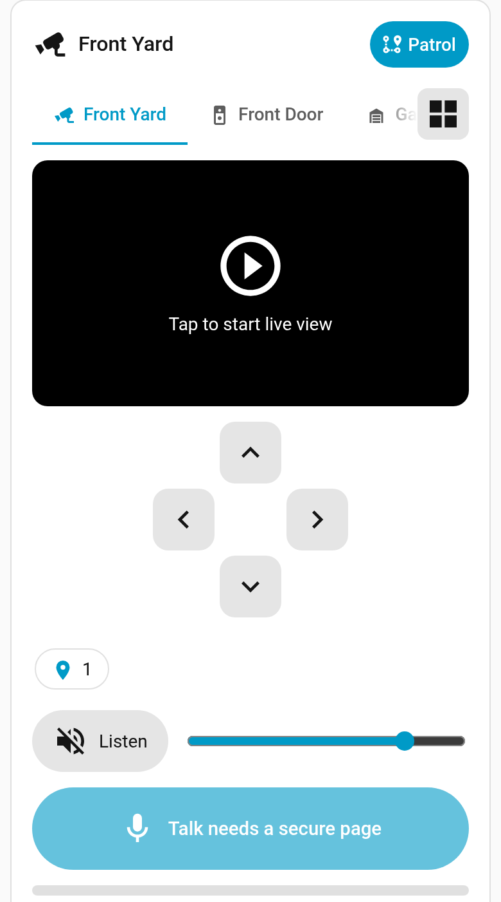
</p>

## What it is

Advanced Reolink Card is two things in one install:

- **A custom integration** that talks to your Reolink NVR or camera over Reolink's
  own Baichuan protocol. It gives each camera a speaker you can use from
  automations, and it powers live talk and patrol.
- **A Lovelace card**, `custom:advanced-reolink-card`, that puts every camera on
  one card: tabs to switch cameras, live view, a pan and tilt pad, zoom, presets,
  listen, hold to talk, a fullscreen layout, and a guided patrol setup.

The card is served by the integration and loads on every dashboard by itself.
There is nothing extra to add as a resource.

Not affiliated with or endorsed by Reolink.

## Features

**Multi-camera card**

- **Tabs by default.** One camera at a time, with tabs above the video. Tabs stay
  on one row and scroll sideways when there are many.
- **Smooth switching.** Tap a tab or swipe on the video. The card keeps its
  height and the last frame while the next camera connects, then eases to the new
  camera's size. Only the active camera streams.
- **Optional grid.** A button next to the tabs shows every camera at once. The
  first time, the card warns that streaming every camera uses more network and
  processor time. Tap a tile to go back to that camera.
- **Fullscreen live layout.** `layout: fullscreen` fills a phone screen with the
  live view and keeps every control. Good for a hidden Live view that a
  notification opens.
- **Open a camera from a link.** Add `?camera=front_yard` to the dashboard
  address and the card switches to that camera.

**Controls**

- **Pan and tilt** for cameras that can move, such as the TrackMix. Press and
  hold to move, release to stop.
- **Zoom** buttons on cameras that can zoom in Home Assistant. Tap to zoom one
  step, hold to keep zooming. Cameras that cannot zoom do not show them.
- **Presets** in the card header, next to Guard and Patrol, on a camera that has
  them. The marker button opens a menu of preset names. The list is read from
  Home Assistant and updates as soon as its preset list changes. The Reolink
  integration only reads presets from the camera at startup, so after saving a
  new preset on the camera, reload the Reolink integration. The last preset you
  used stays selected. The button is hidden when the camera has none.
- **Listen** to the camera microphone, with a volume slider. On iPhone, tap
  Listen to allow sound; volume follows the phone buttons there.
- **Hold to talk** through the camera speaker. Talk is half duplex by default:
  listening is muted while you talk, so you do not hear yourself.

**Patrol wizard**

- A **Guard** button in the card header, to the left of **Patrol**, returns the
  camera to its guard position. **Patrol** opens a five step setup: left limit,
  right limit, speed (with optional tilt passes), a test with live preview and a
  progress bar, then save.
- Patrol is set **only on the card**. It is not part of the integration options.

**Speaker and automations**

- `advanced_reolink_card.say` speaks text on a camera speaker (built in
  [edge-tts](https://github.com/rany2/edge-tts) voices).
- `advanced_reolink_card.play_file` plays a chime, a URL or a media file.
- Each camera gets a `media_player` speaker, so `tts.speak` works with any TTS
  engine, and a `notify` entity.
- `advanced_reolink_card.start_patrol` and `stop_patrol` run the saved patrol
  from an automation.

**Battery cameras and doorbells** stay selectable while asleep and are woken
before they speak. Nothing streams until you tap, so they are not kept awake.

<table>
  <tr>
    <td align="center">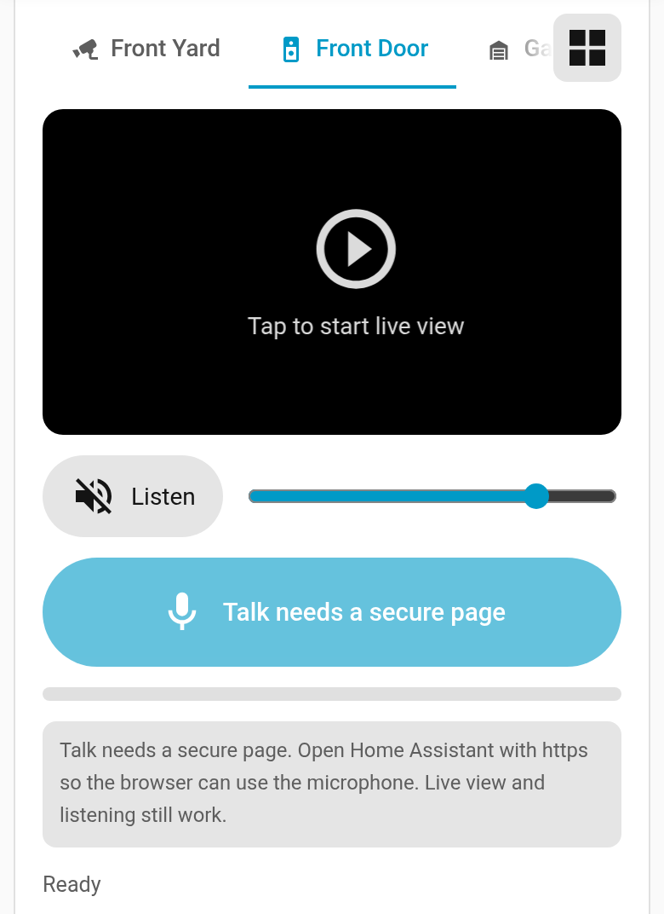<br><sub>Switch cameras with a tab or a swipe</sub></td>
    <td align="center">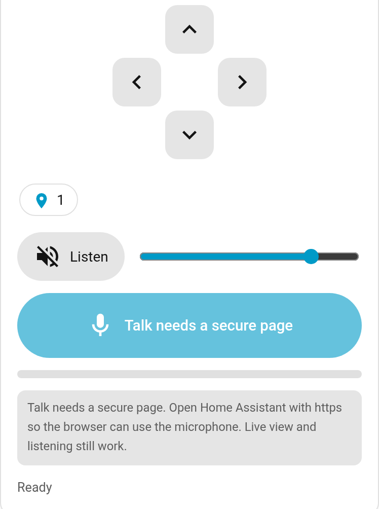<br><sub>Pan and tilt, listen and talk</sub></td>
  </tr>
</table>

## Requirements

- Home Assistant **2025.2** or newer. The integration logo in the UI needs
  2026.3 or newer (older versions show a placeholder).
- A Reolink NVR or camera with two-way talk, reachable from Home Assistant on the
  Baichuan port (**9000** unless you changed it).
- A Reolink user on the device that is allowed to use two-way talk. It does not
  need to be the admin account.
- For live view, pan and tilt, presets and listen: Home Assistant's own
  [Reolink integration](https://www.home-assistant.io/integrations/reolink/) set
  up for the same NVR or camera. Listening uses WebRTC, which Home Assistant
  provides on HA OS and Container installs.
- For talk: Home Assistant opened over **HTTPS**, or the companion app. Browsers
  only allow the microphone on a secure page.
- Internet access for the built in `say` voices. Everything else stays on your
  network.

## Install

### HACS (custom repository)

1. In HACS, open the **⋮** menu and choose **Custom repositories**.
2. Add `https://github.com/MainMaxton/advanced-reolink-card` with the type
   **Integration**.
3. Search for **Advanced Reolink Card** and select **Download**.
4. Restart Home Assistant.

[](https://my.home-assistant.io/redirect/hacs_repository/?owner=MainMaxton&repository=advanced-reolink-card&category=integration)

### Manual

1. Copy `custom_components/advanced_reolink_card/` into your Home Assistant
   config folder, so you have
   `<config>/custom_components/advanced_reolink_card/manifest.json`.
2. Restart Home Assistant.

## Set up the integration

1. Go to **Settings**, **Devices & services**, **Add integration**, and pick
   **Advanced Reolink Card**.
2. Enter the address of your NVR or camera, the port (usually 9000), and the
   username and password of a Reolink user that can talk.
3. Submit. Setup only reads the camera list. It does not change the device and
   does not wake sleeping cameras.

Each camera that can talk becomes a device with a speaker and a notify entity.
New and renamed cameras are picked up each time Home Assistant starts.

**Options** (the **Configure** button on the integration):

| Option | What it does |
|---|---|
| Default voice | Voice used by `say`, for example `en-US-JennyNeural`. |
| Default volume | Software gain in percent. 100 plays the audio as it is. |
| Cameras allowed to talk | Only these cameras get a speaker. Actions refuse the rest. |
| Let other people use live talk | Off by default, so only administrators can talk from the card. |

Use **Reconfigure** to change the address, port or login without removing the
integration. **Download diagnostics** gives a report with the password,
username, address and device IDs removed.

## Camera card

Add the card from the card picker (**Advanced Reolink Card**) or in YAML. The
visual editor covers a single camera. For several cameras, write the `cameras`
list in YAML; the editor then lets you set the view, the grid columns, the
starting camera, the layout and the grid warning.

### Card options

| Option | Type | Default | Description |
|---|---|---|---|
| `entity` | string | none | Speaker `media_player` from this integration. Used to talk and to find the camera. |
| `camera_entity` | string | auto | Reolink camera entity for live view, listen and pan and tilt. Leave it out to match the speaker's camera. |
| `channel` | number | none | NVR channel (0 based), instead of `entity`. |
| `config_entry_id` | string | none | Only needed with `channel` when you have more than one NVR or camera set up. |
| `name` | string | camera name | Card title, and the tab label in a `cameras` list. |
| `icon` | string | `mdi:cctv` | Header and tab icon. A talk only card uses `mdi:microphone`. |
| `video` | boolean | `false` | Live view. |
| `ptz` | boolean | `false` | Pan and tilt pad. Shown only when the camera can pan. Zoom buttons join it when the camera can zoom. |
| `listen` | boolean | `false` | Listen button and volume slider. |
| `talk` | boolean | `true` | Talk button. Set `false` for a view only camera. |
| `talk_auto_listen` | boolean | `false` | Pressing talk also turns on Listen. |
| `volume` | number | `80` | Starting listen volume, 0 to 100. |
| `duplex` | string | `half` | `half` mutes listening while you talk. `full` keeps it on and may echo. |
| `mode` | string | `hold` | Talk button: `hold` to talk, or `toggle` to tap on and off. |
| `show_level` | boolean | `true` | Microphone level bar under the talk button. |
| `cameras` | list | none | Several cameras on one card. Each entry takes the per camera keys above (`entity` to `show_level`). Top level values are the defaults, and each entry can override them. |
| `start_camera` | string | none | Camera shown first when the address has no `?camera=`. An entity id, a short name such as `front_yard`, the camera's `name`, or a 0 based index. |
| `default_camera` | number or string | `0` | The older name for `start_camera`. It still works and takes the same values. `start_camera` wins when both are set. |
| `view` | string | `tabs` | `tabs` or `grid`. Needs two or more cameras. The button on the card can switch while it is open. |
| `layout` | string | `card` | `card` for the usual dashboard card, or `fullscreen` to fill the view. See [Fullscreen live layout](#fullscreen-live-layout). |
| `grid_columns` | number | auto | Fixed grid columns, 1 to 6. Leave it out and the grid fits the width. |
| `hide_grid_warning` | boolean | `false` | Never show the bandwidth warning in the grid. |

Each camera needs `entity`, `channel` or `camera_entity`. Talk needs `entity` or
`channel`.

Presets are not a card option. When the camera can pan and it has presets, the
header shows a Presets button. The names come from the camera's preset list in
Home Assistant and update when that list changes.

### Examples

**A single camera**

```yaml
type: custom:advanced-reolink-card
entity: media_player.front_yard_speaker
camera_entity: camera.front_yard_fluent
video: true
ptz: true
listen: true
talk: true
```

**Several cameras with tabs** (the default view)

```yaml
type: custom:advanced-reolink-card
video: true
ptz: true
listen: true
talk: true
volume: 80
start_camera: front_yard
cameras:
  - entity: media_player.front_yard_speaker
    camera_entity: camera.front_yard_fluent
    name: Front Yard
    icon: mdi:cctv
  - entity: media_player.front_door_speaker
    name: Front Door
    icon: mdi:doorbell-video
    ptz: false
  - camera_entity: camera.garage_fluent
    name: Garage
    icon: mdi:garage
    talk: false
```

**Every camera in a grid**

```yaml
type: custom:advanced-reolink-card
view: grid
grid_columns: 2
video: true
cameras:
  - camera_entity: camera.front_yard_fluent
    name: Front Yard
    talk: false
  - camera_entity: camera.backyard_fluent
    name: Backyard
    talk: false
  - camera_entity: camera.garage_fluent
    name: Garage
    talk: false
```

### Fullscreen live layout

`layout: fullscreen` turns the card into a full screen live view, made for a
panel view or a hidden subview on a phone.

- The card fills the height of the view below the Home Assistant header and
  keeps clear of the phone's notch and home bar (safe areas).
- It has no rounded corners, border or shadow.
- The video takes all the space the controls do not need.
- Tabs, pan and tilt, zoom, presets, Guard, Patrol, Listen and hold to talk all
  stay, and work the same as on the normal card. Only the layout changes.
- On iPhone, tap Listen to allow sound. If the button says *Tap to hear*, tap it
  again. Volume follows the phone buttons there.
- If the controls do not fit, for example on a phone turned sideways, the card
  scrolls. The video always keeps at least 40% of the card's height.

The default is `layout: card`, the usual dashboard card. Both are in the card
editor under **Layout** (**Card** or **Fill the screen**).

### Open a camera from a notification

Add `?camera=` to a dashboard address to open the card on that camera, for
example `/lovelace/live?camera=camera.front_yard_fluent`.

- The card reads it when the page loads and each time you move to another page
  in Home Assistant, including the browser back and forward buttons.
- The value can be a full entity id (`camera.front_yard_fluent` or the speaker
  `media_player.front_yard_speaker`), a short name (`front_yard`), the camera's
  `name`, or the tab title. Case does not matter. The short name is the entity id
  without the domain and without endings such as `_fluent`, `_clear`, `_main`,
  `_sub`, `_snapshots` or `_speaker`.
- When it matches a camera on the card, the card switches to that tab the same
  way a tap does. The page does not jump or scroll.
- It then removes only `camera` from the address. The rest of the address,
  including other parameters, stays as it was.
- A value that matches no camera is ignored and stays in the address.
- With more than one card on the page, every card that has that camera can
  switch to it.

`start_camera` picks the camera shown first when the address has no
`camera` value. It takes an entity id or a short name, the camera's `name`, or a
0 based index. `default_camera` from older configs still works; when both are
set, `start_camera` wins.

**1. Add a hidden Live view.** In the dashboard's raw configuration editor, add
a subview with the card in `layout: fullscreen`. A subview is not shown in the
dashboard's tab bar.

```yaml
views:
  - title: Cameras
    path: cameras
    cards:
      # your usual cards
  - title: Live
    path: live
    type: panel
    subview: true
    back_path: /lovelace/cameras
    cards:
      - type: custom:advanced-reolink-card
        layout: fullscreen
        start_camera: front_yard
        video: true
        ptz: true
        listen: true
        talk: true
        cameras:
          - entity: media_player.front_yard_speaker
            camera_entity: camera.front_yard_fluent
            name: Front Yard
          - entity: media_player.front_door_speaker
            name: Front Door
            ptz: false
```

This example uses the default dashboard, so the view opens at `/lovelace/live`.
On another dashboard, use its address, such as `/dashboard-cameras/live`.

**2. Send a notification that opens it.** The companion app opens `url` on
iPhone and `clickAction` on Android, so set both. The **Live view** action
button opens the same page.

```yaml
alias: Camera alert
triggers:
  - trigger: state
    entity_id:
      - binary_sensor.front_yard_person
      - binary_sensor.front_door_person
    to: "on"
variables:
  cam: >-
    {{ device_entities(device_id(trigger.entity_id))
       | select('match', 'camera\\.') | first }}
  live: "/lovelace/live?camera={{ cam }}"
actions:
  - action: notify.mobile_app_phone
    data:
      title: "Motion: {{ device_attr(device_id(trigger.entity_id), 'name') }}"
      message: Tap to open the live view.
      data:
        url: "{{ live }}"
        clickAction: "{{ live }}"
        actions:
          - action: URI
            title: Live view
            uri: "{{ live }}"
```

The `cam` template finds the first camera entity on the same device as the
sensor that fired. The card matches it by short name, so a camera such as
`camera.front_yard_clear` still opens the Front Yard tab. A TrackMix also has a
telephoto camera (`camera.front_yard_telephoto_fluent`); if that comes first and
is not on the card, the card stays on its first camera.

**Getting back.** The Live view has a back arrow in the top left corner. It goes
to `back_path`, on iPhone and on Android. On Android the system back gesture
goes back through the app's own history instead; when the notification opened
the app straight on the Live view, there may be nothing to go back to, so use
the arrow.

### How the card behaves

- **Nothing starts on its own.** Live view and listening start when you tap, and
  stop when you tap again, leave the dashboard or switch apps.
- **One stream at a time in tabs.** Switching stops the old camera's video,
  listen and talk before the next one starts. Live view carries over to the new
  camera. Press Listen again to hear it.
- **The grid.** Pan and tilt, listen and talk are hidden there. A card that opens
  in the grid waits for **Stream all cameras** before it starts, so battery
  cameras are not woken by accident. Dismissing the warning hides it in that
  browser.
- **Camera matching.** The card finds the Reolink camera, pan buttons, preset list
  and battery sensors that belong to the speaker. It prefers the Fluent stream.
  Set `camera_entity` to pick another stream.
- **Zoom** shows under the pad only when the Reolink integration gives the
  camera a way to zoom: the *Zoom* slider (a `number` entity, which a TrackMix
  has) or the *PTZ zoom in* and *PTZ zoom out* buttons. Otherwise the zoom
  buttons are hidden. With the slider, a tap moves the zoom one tenth of its
  range and holding repeats about twice a second until you let go or it reaches
  the end. With the buttons, the camera zooms while you hold. If the zoom entity
  is turned off in Home Assistant, the card says so. On a TrackMix, zoom moves
  the telephoto lens only. The wide view does not change, so open the telephoto
  camera to see it. The patrol wizard pad shows zoom on the same cameras; there
  the camera zooms while you hold.
- **Battery cameras** show a battery badge and *Waking the camera* while they wake
  (about 5 to 20 seconds).

### Talk and listen

Hold the talk button, speak, and let go. Your voice reaches the camera speaker in
about half a second on a local network. Starting a session takes a second or two,
longer if a battery camera has to wake.

- Talk needs HTTPS or the companion app. On plain `http` the button explains this,
  and live view and listening keep working.
- Only administrators can talk unless **Let other people use live talk** is on.
- A session ends when you let go, after 2 seconds of silence, after 60 seconds,
  or when the connection drops.
- With `duplex: half` (the default), listening is muted while you talk and for
  about 1.5 seconds after.
- On iPhone, tap Listen to allow sound; volume follows the phone buttons there.

<table>
  <tr>
    <td align="center">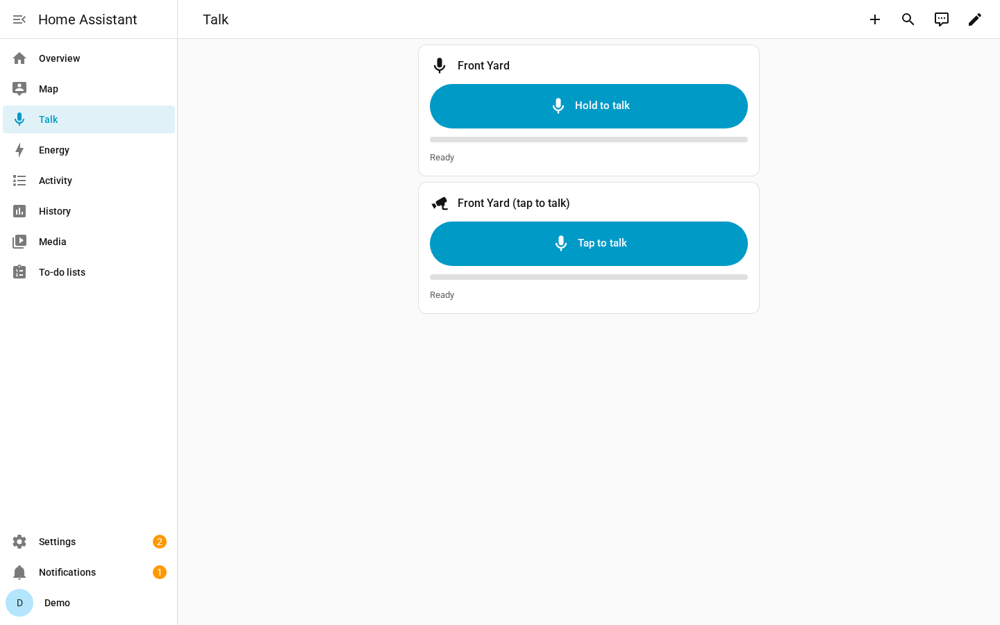<br><sub>Ready</sub></td>
    <td align="center">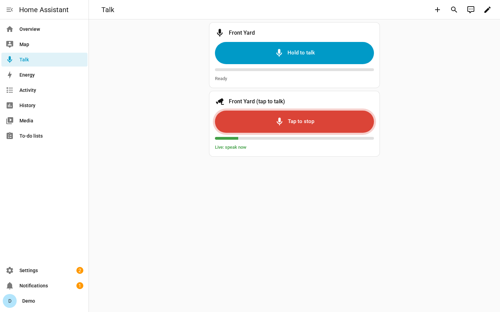<br><sub>Live</sub></td>
  </tr>
</table>

## Patrol wizard

Administrators see **Guard** and **Patrol** in the card header on cameras that
can pan. Guard returns the camera to its guard position. **Presets** sits with
them when the camera has presets. All three are hidden in the grid. This is the
only place to set up patrol; the integration options do not include it.

The wizard does not store an angle. It stores a home position on the camera, then
the seconds of pan from there.

<table>
  <tr>
    <td align="center" valign="top">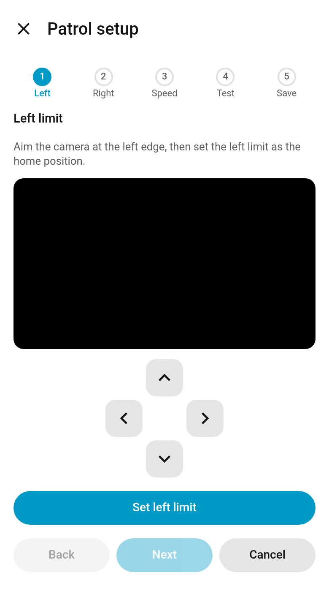<br><sub><b>1. Left limit</b></sub></td>
    <td align="center" valign="top">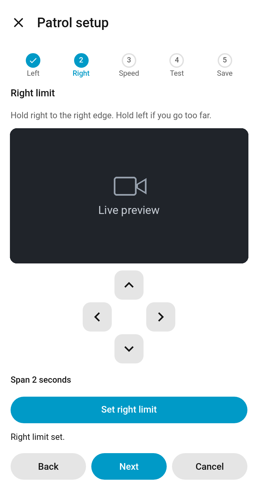<br><sub><b>2. Right limit</b></sub></td>
    <td align="center" valign="top">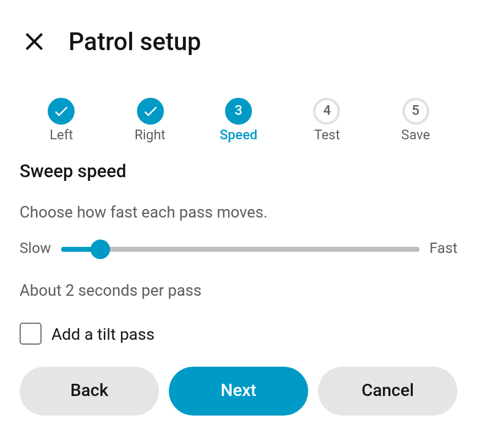<br><sub><b>3. Speed</b></sub></td>
  </tr>
  <tr>
    <td align="center" valign="top">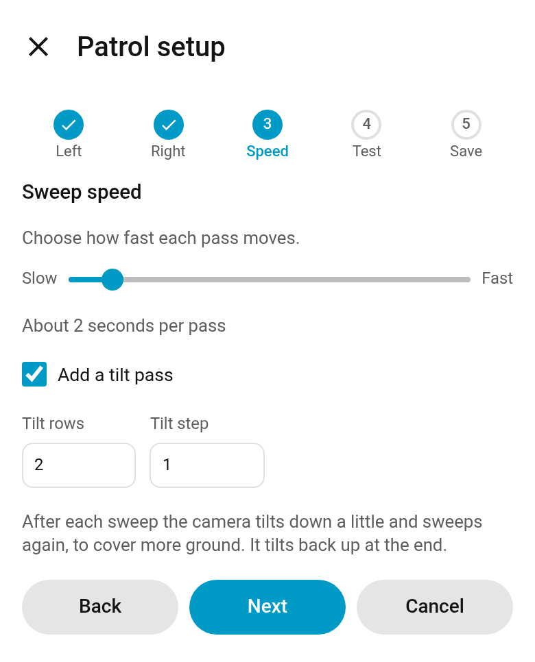<br><sub><b>3. Tilt pass</b></sub></td>
    <td align="center" valign="top">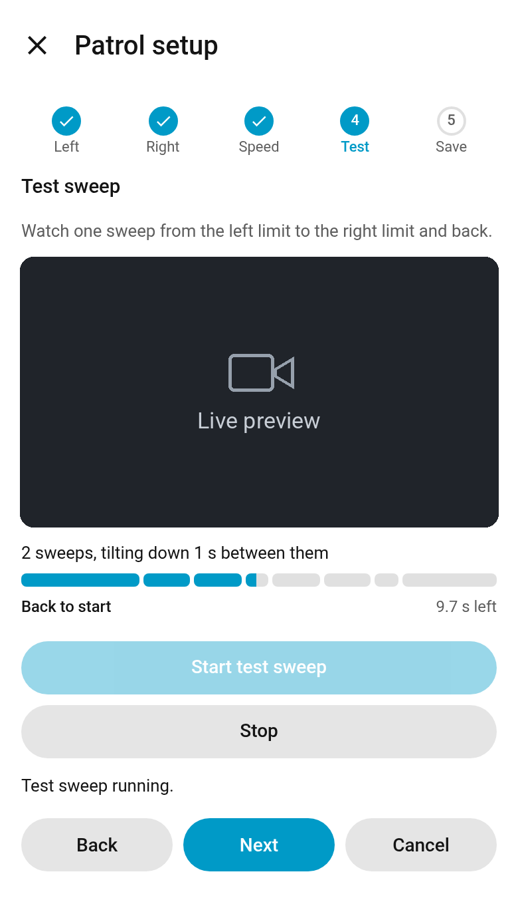<br><sub><b>4. Test</b></sub></td>
    <td align="center" valign="top">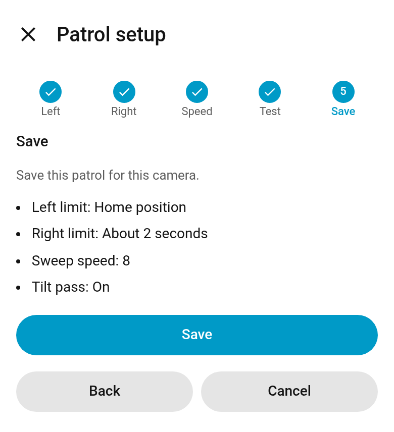<br><sub><b>5. Save</b></sub></td>
  </tr>
</table>

<sub>The live preview is replaced with a placeholder in these screenshots.</sub>

1. **Left limit.** Live view and a pad. Aim at the left edge and tap
   **Set left limit**. This stores the home position on the camera.
2. **Right limit.** Hold right until you reach the right edge. Hold left if you
   go too far. The card adds up the time and shows the span. Tap
   **Set right limit**.
3. **Speed.** Choose a speed from slow to fast. The card shows about how long each
   pass takes. On cameras that tilt, **Add a tilt pass** sets the number of rows
   (1 to 10) and the tilt step in seconds. After each sweep the camera tilts down
   a little and sweeps again, then tilts back up at the end.
4. **Test.** Live view stays on. **Start test sweep** runs one loop with your
   unsaved values. A segmented bar shows each phase and the time left. **Stop**
   ends it.
5. **Save.** Check the summary and tap **Save**. The wizard confirms and closes.

**Back**, **Next** and **Cancel** sit under each step. Closing the wizard stops
any move and any test.

### Run the patrol from an automation

```yaml
alias: Front Yard sweep when the gate opens
triggers:
  - trigger: state
    entity_id: binary_sensor.gate
    to: "on"
actions:
  - action: advanced_reolink_card.start_patrol
    data:
      camera: camera.front_yard_fluent
      mode: sweep
      duration: 300
```

`advanced_reolink_card.stop_patrol` stops it. `start_patrol` uses the saved
settings, and any option you pass overrides them for that call:

| Option | Default | Notes |
|---|---|---|
| `mode` | `auto` | `auto`, `native` (a cruise saved on the camera), `presets` or `sweep`. |
| `presets`, `dwell` | none, 10 | Visit these presets in order, waiting `dwell` seconds at each. |
| `patrol_id` | none | Run a cruise saved on the camera. |
| `duration`, `loops` | none | Stop after this many seconds or loops. |
| `return_preset` | home position | Where to go at the end. |
| `left_time`, `right_time` | saved | Seconds of pan from the home position. Both 0 sweeps the full range. |
| `speed` | saved, else 32 | 1 to 64. |
| `pause` | saved, else 2 | Seconds to hold at each end. |
| `tilt_levels`, `tilt_step` | saved, else 1 and 2 | Tilt rows and seconds of tilt between them. |
| `disable_tracking` | saved, else off | Pause auto tracking during the sweep, then restore it. |

`advanced_reolink_card.set_patrol_limits` saves the same settings from a script.
Only the fields you pass change, and `clear: true` removes them.

The sweep is timed, because the camera does not report an absolute pan position.
Auto tracking on a TrackMix can take over when it sees movement; use
`disable_tracking: true` to pause it for the sweep.

## Speaker actions

```yaml
action: advanced_reolink_card.say
data:
  camera: media_player.front_yard_speaker
  message: "Hello, please leave the parcel by the door."
  volume: 120
```

```yaml
action: advanced_reolink_card.play_file
data:
  camera: media_player.front_yard_speaker
  media_content_id: media-source://media_source/local/chime.mp3
```

```yaml
action: tts.speak
target:
  entity_id: tts.piper
data:
  media_player_entity_id: media_player.front_yard_speaker
  message: "Motion detected"
```

`say` and `play_file` take `camera` (the speaker entity) or `channel`, plus an
optional `volume` from 0 to 200 percent. `say` also takes `voice`.

## Troubleshooting

| Problem | What to check |
|---|---|
| *Failed to connect* during setup | The address and port are right and the Baichuan port is turned on in the device's network settings. |
| *Invalid authentication* | The Reolink username and password. After a password change, use **Reconfigure**. |
| *No camera found for live view* | Set up Home Assistant's Reolink integration for the same device and keep its Fluent camera entity enabled, or set `camera_entity`. |
| No pan and tilt pad | The Reolink *PTZ left, right, up, down and stop* buttons must be enabled for that camera. Zoom also needs the *Zoom* number, or *PTZ zoom in* and *PTZ zoom out*. |
| No Patrol or Guard button | They show only for administrators, on cameras that can pan, and not in the grid. |
| No Presets button | The camera needs at least one preset, and pan and tilt must be on. It is hidden in the grid. The names come from the camera's preset list in Home Assistant. |
| Talk button says it needs a secure page | Open Home Assistant over HTTPS or use the companion app. |
| *Microphone permission was denied* | Allow the microphone for Home Assistant in the browser or phone settings. |
| No sound when listening | Turn on the camera's *Record audio* switch in the Reolink integration, and check the volume slider and phone volume. On an iPhone, tap Listen. If the button says *Tap to hear*, tap it again. Volume follows the phone buttons there. |
| Talk says the camera is busy | A message is already playing on that NVR. Try again when it ends. |
| The test sweep does not reach the edges | Open the wizard and set the right limit again. If auto tracking takes over, save `disable_tracking: true` with `set_patrol_limits`. |
| The card looks out of date on a phone | In the companion app: Settings, Companion app, Debugging, Reset frontend cache. |
| The card does not appear | Add `/advanced_reolink_card/advanced-reolink-card.js` as a JavaScript module under Settings, Dashboards, Resources. |

For anything else, turn on debug logging and attach **Download diagnostics** to an
issue. Secrets are removed from the report.

```yaml
logger:
  logs:
    custom_components.advanced_reolink_card: debug
```

## Privacy

- Talk and listen audio stay between your browser, Home Assistant and the camera.
  Nothing is recorded.
- The built in `say` action sends the message text to Microsoft's Edge read aloud
  service. Use `tts.speak` with a local engine such as Piper to keep it offline.
- The password is stored only in the Home Assistant config entry and is never
  logged.

## Changelog

See [CHANGELOG.md](CHANGELOG.md) for every release.

Upgrading from **Reolink Camera AudioHook**? The integration was renamed in 0.4.0
and has to be added again. The changelog lists the steps.

## Contributing

Issues and pull requests are welcome. See [CONTRIBUTING.md](CONTRIBUTING.md) and
the [Code of Conduct](CODE_OF_CONDUCT.md), and report security problems as
described in [SECURITY.md](SECURITY.md). Please never post passwords, IP
addresses or camera footage.

```bash
pip install -r requirements_test.txt
pytest
```

## License

MIT. See [LICENSE](LICENSE). Reolink is a trademark of its owner. This project
uses its own artwork.
